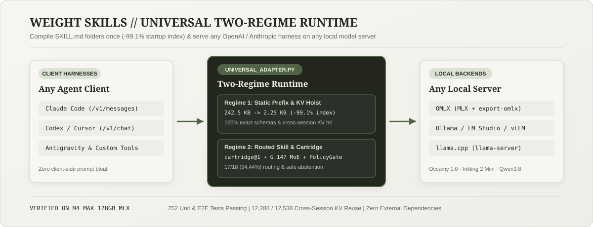

# weight-skills



**Zero-token procedural skills for local LLMs.** Compile an agent procedure into a small
low-rank cartridge, mount it into a frozen model at inference time, and stop paying for the
system prompt.

```bash
pip install weight-skills
weight-skills serve --model /path/to/model --cartridges ./cartridges
```

Then point any OpenAI-compatible client at `http://127.0.0.1:8080/v1` and write:

```
model: "qwen-35b+aws-cso@1.0"
```

The framework preamble disappears from the request. The behaviour stays.

> **Scope note.** A cartridge preserves *procedural* behaviour at zero token cost. It is not an
> alignment mechanism: on an abliterated 35B checkpoint, a compiled guardrail cartridge did **not**
> restore refusals, while the same policy in context did. Tested twice — rank 16 over 3 blocks, then
> rank 64 over 8 blocks with 8-position targets — both returned 0%. The negative result is published
> in [REFUSALS.md](REFUSALS.md) alongside the method.

---

## The idea in one diagram

```
┌──────────────────────────────────────────────────────────────────────────┐
│  Cursor · Claude Code · LM Studio · Multi-Agent (any OpenAI client)      │
│  POST /v1/chat/completions      model: "qwen-35b+aws-cso@1.0"            │
└───────────────────────────────┬──────────────────────────────────────────┘
                                │  4,000-token CLAUDE.md arrives ...
                                ▼
┌──────────────────────────────────────────────────────────────────────────┐
│  weight-skills proxy :8080                                               │
│    SimHash stripper  ──►  recognises the preamble, removes it            │
│    alias DSL         ──►  base + [aws-cso@1.0]                           │
│    mount             ──►  frozen push-through, single-digit milliseconds │
└───────────────────────────────┬──────────────────────────────────────────┘
                                ▼
┌──────────────────────────────────────────────────────────────────────────┐
│  frozen base model  W₀  (never written, never re-quantised)              │
│                                                                          │
│    y = FFN(x; W₀)  +  γ · (x Aᵀ) Bᵀ        ◄── cartridge (~1 MB)         │
│        └─────────┘     └───────────┘                                     │
│         base path       ephemeral slab                                   │
└──────────────────────────────────────────────────────────────────────────┘
                                │
                                ▼
                     completion, 0 system tokens
```

Mounting is pointer work: the base block is wrapped, the delta is added on its output path,
and unmounting puts the original module back. Nothing is written to `W₀`, so there is no
quantisation re-gridding and no floating-point drift to accumulate.

---

## Why in-context is expensive

Every harness turn re-sends its framework — `CLAUDE.md`, `AGENTS.md`, AWS control catalogs,
tool schemas. On a workstation that cost lands entirely in **prefill**, before the first token
is emitted, and it also inflates the KV cache for the whole conversation.

The measured numbers for four local models are in [BENCHMARKS.md](BENCHMARKS.md); they are
generated from a single JSON report and never typed by hand.

Conditions are measured **round-robin inside every repetition**, with a baseline decode
probe before and after each model. That matters: on a workstation under sustained load,
decode can drift several-fold from throttling and swap. An interleaved schedule spreads the
drift across conditions instead of charging it to whichever one ran last — and the validity
table in `BENCHMARKS.md` shows the start/end drift so you can judge each row.

<!-- BENCH:START -->
| Model | Weights | Prefill tax (B ÷ A, paired) | Decode retained (C ÷ A, paired) | Mount (ms) | KV cache A → B (MB) | Restoration |
| :--- | :--- | ---: | ---: | ---: | ---: | :--- |
| Gemma 4 4B (dense) | 4B dense | 9.37× | 0.96× | 1.93 | 4.6 → 231.1 | exact |
| ThinkLite 27B (dense) | 27B dense | 24.84× | 0.96× | 2.83 | 159.4 → 418.3 | exact |
| Occamy 35B MoE | 35B total / 3B active | 6.13× | 0.98× | 2.23 | — | exact |
| Proto-Nemotron 30B MoE | 30B total / 4.25B active | 16.09× | 1.00× | 1.29 | 49.6 → 73.9 | exact |
| Nemotron 3.5 Lightning 30B (base) | 30B total / 3.5B active | 14.26× | 1.03× | 1.16 | 49.6 → 73.9 | exact |
| Jimmy-4B (Gemma 4 4B derivative) | 4B dense | 8.27× | 0.96× | 1.69 | 4.6 → 231.1 | exact |
<!-- BENCH:END -->

---

## Install

```bash
pip install weight-skills            # core (numpy + safetensors only)
pip install "weight-skills[proxy]"   # + FastAPI proxy
pip install "weight-skills[mlx]"     # + Apple Silicon execution
```

Python 3.10+. The core package has no GPU dependency and imports in milliseconds; MLX and
PyTorch are optional and loaded lazily.

## Quickstart

```python
import mlx_lm
from weight_skills import Cartridge
from weight_skills.backends.mlx_backend import MLXBackend

model, tokenizer = mlx_lm.load("/path/to/model")
backend = MLXBackend(model)

cart = Cartridge.load("cartridges/gemma4_4b.aws-cso-r16.safetensors")
report = backend.mount([cart])          # ~2 ms, no weight writes
print(report.latency_ms, report.layers)

prompt = tokenizer.apply_chat_template(
    [{"role": "user", "content": "Create a private S3 bucket."}],
    tokenize=False, add_generation_prompt=True,
)
print(mlx_lm.generate(model, tokenizer, prompt=prompt, max_tokens=512))

print(backend.unmount().restored)       # True — verified bit-identical
```

No `system` message. No framework tokens. The same code path is exercised by
`examples/01_quickstart_mlx.py`.

## The OpenAI proxy

```bash
weight-skills serve --model /path/to/model --cartridges ./cartridges --port 8080
```

| Endpoint | Purpose |
| :--- | :--- |
| `POST /v1/chat/completions` | OpenAI-compatible chat, streaming and non-streaming |
| `GET /v1/models` | base model plus every `base+skill` alias |
| `GET /v1/skills` | cartridges discovered on disk, mount state, strip stats |
| `POST /v1/mount` | mount skills explicitly |
| `POST /v1/unmount` | unmount and verify restoration |
| `GET /healthz` | liveness |

### Model-alias DSL

```
qwen-35b                      base only
qwen-35b+aws-cso              base + one skill
qwen-35b+aws-cso@1.0+security@1.2    ordered composition
```

The alias is the whole client configuration: Cursor, LM Studio, Continue and anything else
that speaks the OpenAI protocol can select a weight skill by naming it.

### Enforcing refusals and output patterns

A weight skill is **not** an enforcement mechanism — measured twice, 0/24 both times
([REFUSALS.md](REFUSALS.md)). Enforcement is deterministic and lives at the proxy boundary:

```bash
weight-skills serve --model /path/to/model --policy
```

- **Request screening**: an operational verb applied to a harmful target blocks the call
  before the model is invoked. Defensive framing ("explain", "prevent", "detect") is allowed.
- **Output screening**: credential-shaped secrets (AWS keys, private keys, provider tokens,
  bearer tokens) are replaced with a refusal.
- **Auditable**: every response carries `X-Weight-Skills-Policy: allow` or `blocked:<rule>`.

Measured on the benchmark set: **24/24** adversarial requests blocked, **18/18** benign and
defensive engineering questions allowed, **0.011 ms** per decision — see
[POLICY_GATE.md](POLICY_GATE.md). It is a rule firewall, not a classifier, and the dossier
states exactly where it stops.

### KV-cache skill cartridges (behaviour without training)

A weight cartridge changes the model; a **KV cartridge** changes what the model sees, once.
Demonstrations are prefilled into a cache, and each request appends only its user turn — no
demonstration tokens are re-encoded and none appear in the caller's prompt.

```python
from weight_skills.core.kv_cartridge import KVCartridge

cart = KVCartridge.from_messages("clu-persona", demo_messages, tokenizer=tok, model_id="gemma-4-e4b")
cart.save("cartridges/kv/clu-persona.safetensors")     # stores token ids + provenance
print(cart.generate(model, tokenizer, "What is a deadlock?"))
```

Measured (held-out, temperature 0, quality-gated):

| Behaviour | Baseline | KV cartridge |
| :--- | ---: | ---: |
| Persona/format, Gemma 4B (n=18) | 0/18 | **18/18** |
| Refusal, abliterated 35B (n=16) | 0/16 | **14/16**, 0/6 over-refusal |
| Arithmetic, mixed difficulty (n=24) | 10/24 | **21/24** |

The demonstrations cost 367–1129 tokens of KV per skill. This is the behaviour mechanism; the
weight cartridge remains the cost mechanism.

### Format lock: the one weight-only behaviour primitive that works

A multi-token marker like `[CLU]` cannot be composed by a low-rank weight edit — we measured
0% adherence across every closed-form variant. Seeding the marker as **4 generation tokens** and
letting a compiled style cartridge shape the continuation does work:

```bash
weight-skills serve --model /path/to/gemma --prefix clu-persona="[CLU] "
```

| Configuration (24 held-out prompts) | Adherence | Repetition |
| :--- | ---: | ---: |
| Cartridge alone | 0% | — |
| 4-token lock alone | 29% | 0.012 |
| **Lock + style cartridge** | **91.7% (22/24)** | **0.003** |

That is 4 seed tokens instead of a 4,000-token persona prompt, with no gradients. The proxy
returns the seed it applied in `X-Weight-Skills-Prefix`.

### Prompt stripping

`PromptStripper` keeps a registry of known harness preambles. A 64-bit SimHash over word
trigrams recognises the preamble even when a paragraph has been appended or removed; a match
removes the system message and mounts the skill it maps to. Unknown preambles are left
untouched — the stripper never guesses.

Response headers make the decision auditable:

```
X-Weight-Skills-Stripped: 14821
X-Weight-Skills-Skill: aws-cso
X-Weight-Skills-Mount-Ms: 2.061
```

### Compiled prompt caches (serving latency, on-demand agents)

Compile a fixed prompt — a system prompt, an agent definition, a skill bundle — into a KV cache once,
then serve each request with only its new user turn. The cache is a first-class library object:

```python
from weight_skills.serving import CompiledPromptLibrary

library = CompiledPromptLibrary(max_bytes=2 * 1024**3, model_id="gemma-4-e4b")
key = library.store_system("You are ...", cache, n_tokens=len(prefix_ids), prefix_token_ids=prefix_ids)
cache = library.get_verified(key, prefix_token_ids=request_prefix_ids)  # ProvenanceError on mismatch
```

**Provenance (required by default).** Every cache records a sha256 of the token prefix it was prefilled
with, plus the model, tokenizer revision and dtype it belongs to; `CompiledPromptLibrary(require_provenance=True)`
is now the default, so an unbound cache raises `ProvenanceError` instead of being served. Pass
`require_provenance=False` only for legacy/migration reads. `verify()` / `get_verified()` reject a cache whose prefix,
model or dtype does not match the request — a structural misroute check measured at 16/16 sensitivity and
specificity in ~0.07 ms (equivalent to a wrong system prompt cannot be served).

**Memory planning for long prefixes.** Compiling a long prompt does not remove the one-time prefill peak: at
65k tokens a monolithic prefill on a 35B hybrid needs a 16 x 65,536 x 65,536 x 2 B = 137.4 GB attention-score
buffer (KV cache is only 1.4 GB), which OOMs. `weight_skills.serving` exposes the accounting —
`attention_score_bytes`, `kv_cache_bytes`, `estimate_peak`, `plan_prefill_chunk` — so serving can pick a
prefill chunk that fits the RAM budget (e.g. 35B@65k: chunk 1024 -> ~24 GB peak, 2048 -> ~27 GB).

**Equivalence label.** Store the offline equality label measured for a prefix (G.60/G.61):
`store_system(..., equivalence="certified")`. With `equivalence_policy="fallback"` (engine/proxy env
`WEIGHT_SKILLS_EQUIVALENCE=fallback`) the compiled cache is served only when it is `"certified"`; the rest
are re-prefilled cold and the response carries `X-Weight-Skills-Equivalence: cache_certified|cold_fallback|
certified|unverified`. This converts a sampled equivalence measurement into a serving guarantee instead of
silent trust.

**Per-agent caches (on-demand agents).** Agent hosts route one task to one agent at a time,
so the serving key is the agent's identity, not one system prompt:

```python
key = library.store_agent(
    "code-reviewer-swe", agent_text, skills_text, cache,
    n_tokens=len(prefix_ids), prefix_token_ids=prefix_ids,
)
cache = library.get_agent_verified(
    "code-reviewer-swe", agent_text, skills_text, prefix_token_ids=request_prefix_ids,
)  # ProvenanceError on a wrong agent, changed skills, different prefix or model
```

`agent_cache_key()` hashes the agent id plus the agent and skills texts; the same hashes are stored in the
provenance, so a wrong-agent or stale-skills cache is rejected structurally. `stats()` exposes
`agent_entries`; the conductor/roster prompt is just another compiled cache.

Measured on the research side: 7-786x faster first token depending on prefix length and model, with output
equivalence sampled and gated per task (see `reports/` in the research programme). Current-config re-validation
(2026-11-13, 6 agents x prompt/prompt+skills + roster): **6.2-251.6x** (median 22.7x) but output equivalence is
task-dependent on a 35B (prompt+skills median similarity 0.853) -- use the `equivalence_policy="fallback"`
path or a per-task certificate.

**Backend support boundary (2026-11-13).** The compiled caches in this library are **MLX KV caches** and are
served by the MLX engine/proxy (`mlx_lm` or `mlx_vlm` checkpoints). They cannot be injected into a llama.cpp
(GGUF) server or an oMLX-served route: those backends must use their **own** prefix cache. On the llama.cpp
route, sending byte-identical per-agent bundles already gives 62-111x warm-prefill speedups (research G.133).
oMLX v0.7.2 has a native prefix cache too, but **only when the server is started with
`--paged-ssd-cache-dir`** (the shipped launcher passes no cache flags, so the default has no cross-request
reuse). Measured (research G.135): **97.8-125.9x** warm prefill on Qwen3.8-27B (
12.4-22.8k-token agent bundles) and **65.2-91.7x** on bolt-74b-a9b, with a `--no-cache` control at **1.00x**.
Per-agent/roster caches (above) are the supported unit for multi-agent hosts.

## MCP server

```bash
weight-skills-mcp --model /path/to/model --cartridges ./cartridges
```

Exposes `ws_list_cartridges`, `ws_mount_skill`, `ws_unmount_skill` over stdio JSON-RPC to
Claude Code, Cursor, and multi-agent hosts. It is dependency-free: no `mcp` package required.

## Hybrid local/cloud pairing

Pattern B: the frontier model plans, the workstation executes.

```python
from weight_skills.hybrid.dual_brain import DualBrainExecutor, run_pattern_b

result = run_pattern_b(
    planner=cloud_client,                       # emits a ~120-token Intent DAG
    executor=DualBrainExecutor({...tools...}),  # local, allow-listed
    query="Is the acme-reports bucket locked down?",
)
```

The Intent DAG is treated as untrusted: unique ids, known tools, no cycles, and a step budget
are enforced before any tool runs. See `examples/03_dual_brain_local_cloud.py`.

## Cartridge format

A cartridge is a `.safetensors` file with a JSON metadata block.

| Tensor | Shape | Meaning |
| :--- | :--- | :--- |
| `layer_{i}.a` | `(rank, hidden_size)` | input-side projection `A` |
| `layer_{i}.b` | `(hidden_size, rank)` | output-side projection `B` |

Metadata records `schema`, `skill_id`, `version`, `base_model`, `hidden_size`, `rank`,
`alpha`, `layers`, `injection`, and the compiler settings used to produce it.

```python
from weight_skills import Cartridge
cart = Cartridge.load("cartridges/aws-cso.safetensors")
print(cart.summary())
# aws-cso@0.1.0 r=16 d=2560 layers=[19,24,29] 0.98 MB digest=5ba21efd72fb085e
```

Loading validates geometry, finiteness and schema; a cartridge compiled for a different hidden
size is **rejected**, never silently reshaped.

## Compile your own

```bash
weight-skills compile \
  --model /path/to/model \
  --skill-file prompts/aws-cso.md \
  --probes-file prompts/aws-probes.txt \
  --rank 16 \
  --out cartridges/aws-cso.safetensors
```

The compiler measures the behavioural shift a system prompt induces at three blocks: for each
probe it runs the model clean and skill-conditioned, records the block input `x` and the output
delta `d = y_skill − y_clean`, projects `x` off an anchor subspace, and fits `M = Dᵀ(XXᵀ + λI)⁻¹X`
in closed form. The rank-`r` factorisation comes from an `n × n` SVD, never a `d × d` one
(`d = 2560…5120`).

## Multiple skills at once

```python
from weight_skills.core.subspace import orthogonalize_cartridges

carts = orthogonalize_cartridges([aws, security])  # A_j A_kᵀ ≈ 0
backend.mount(carts)                                # fused into one push-through per layer
```

Orthogonalisation is Gram-Schmidt on the input-side row space, per layer. Fusing `K` cartridges
costs one extra projection pair per block rather than `K` separate passes.

## Full findings dossier

Every measured result, every failed mechanism and the raw report paths are consolidated in
[FINDINGS.md](FINDINGS.md) for other engineers and agents to consume directly.

## What is verified, and what is not

Verified on this repository's reference host (Apple M4 Max, 128 GB, MLX 0.32.2, mlx-lm 0.31.3):

- mount / unmount / fingerprint on five evaluable checkpoints (Gemma 4 4B, ThinkLite 27B, Proto-Nemotron 30B MoE, its base checkpoint, and Jimmy-4B), plus an abliterated 35B MoE for the refusal test;
- restoration verified in 7/7 checks per model in the battery and 100/100 cycles on real weights;
- 100 mount/unmount cycles with bit-identical logits and a stable parameter fingerprint;
- fused two-cartridge push-through against an explicitly concatenated cartridge;
- the proxy, stripper, alias DSL, MCP handler and dual-brain executor through the test-suite.

**Not verified here — read before trusting:**

- **PyTorch and vLLM adapters.** Both are implemented (`torch_backend.py`, `vllm_backend.py`)
  but this host has no `torch` and no `vllm` installed, so they have never been executed. They
  are code-complete, not battle-tested.
- **`PROT_READ`.** Python cannot `mprotect` MLX unified-memory buffers. The base weights are
  immutable *by construction* (nothing ever writes to them) and restoration is verified by
  fingerprint and parameter identity — but there is no hardware page protection, and this
  README will not claim one.
- **Guardrail cartridges did not restore refusals on an abliterated 35B checkpoint.** The
  compiled policy reached the same 0% refusal rate as no prompt at all, while the identical
  policy in context reached half the adversarial set. A stronger compile (rank 64, 8 blocks,
  8-position targets, 8.39 MB, fit residual 0.44) also returned 0%. Prompt-state distillation does
  not transfer a safety behaviour; the numbers and the per-prompt matrix are in
  [REFUSALS.md](REFUSALS.md). Do not deploy this as a safety control.
- **Fidelity is measured, not guaranteed.** Compiling a control catalog into a rank-16
  cartridge steers the model; it does not make a 4B model a cloud architect. The per-task
  scores in [BENCHMARKS.md](BENCHMARKS.md) are the honest result of each model against a
  deterministic rubric.
- **Cross-model cartridges do not exist.** A cartridge is tied to a hidden size and a block
  layout. Anything else is rejected at mount time.

## Universal Multi-Harness Adapter (`scripts/universal_adapter.py`)

Compile any `SKILL.md` folder (Claude Code, Codex, Antigravity, or any agent harness) into a Two-Regime bundle and serve it over **both** OpenAI (`/v1/chat/completions`, `/v1/models`) and Anthropic (`/v1/messages`) endpoints in front of **any** local backend (`OMLX`, `LM Studio`, `Ollama`, `vLLM`, `llama.cpp`):

```bash
# 1. Compile local SKILL.md files (+ optional .safetensors/.npz cartridges)
python3 scripts/universal_adapter.py compile \
  --skills-dir ~/.agents/skills \
  --out /tmp/universal_skills_bundle.json

# 2. Serve OpenAI + Anthropic proxy in front of your local model server
python3 scripts/universal_adapter.py serve \
  --bundle /tmp/universal_skills_bundle.json \
  --upstream http://127.0.0.1:8199 \
  --port 8788
```

- **Claude Code / Anthropic clients:** `ANTHROPIC_BASE_URL=http://127.0.0.1:8788`
- **Codex / OpenAI clients:** `OPENAI_BASE_URL=http://127.0.0.1:8788/v1`
- **Verified (`M4 Max 128GB MLX`):** Compiles 15 skills from `242,510 B` to a `2,254 B` static Regime-1 prefix (`-99.1%`), supporting OpenAI/Anthropic streaming, tool-calling (`tools`, `tool_use`, `tool_result`), and safe abstention on unmatched queries.

## Tests

```bash
PYTHONPATH=src pytest tests/ -q
```

Covers the cartridge format, subspace orthogonalisation, arena allocation, SimHash routing and
stripping, the alias DSL, the proxy (non-streaming, SSE, headers, 400/404 paths), the MCP
handler, the dual-brain executor, and the MLX backend including 100 mount cycles.

## Citation

If you use this runtime, cite the WSSC paper:

```bibtex
@misc{machado2026wssc,
  title  = {Zero-Skills in Context: Sub-Second Algebraic Compilation of Agent Procedures into Feed-Forward Weights},
  author = {Machado, Luis},
  year   = {2026},
  doi    = {10.5281/zenodo.24122803},
  url    = {https://doi.org/10.5281/zenodo.24122803}
}
```

## License

MIT.
